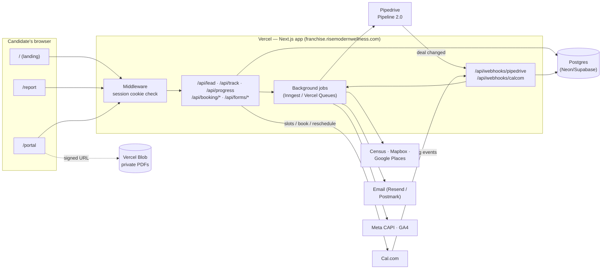
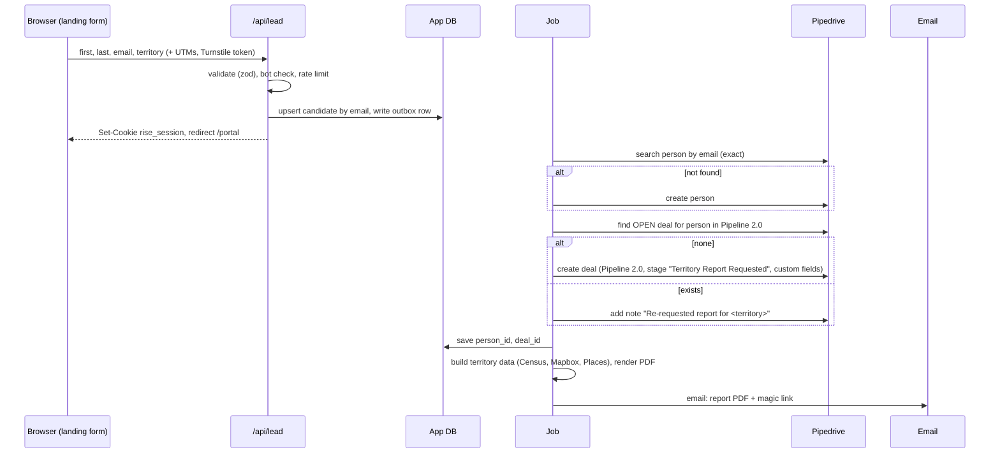

# RISE Franchise Portal — Architecture Blueprint

**Domain:** `franchise.risemodernwellness.com`
**Source designs:** canvas "RISE Franchise Landing Page Mockup" — boards `Main` (landing + opt-in), `Territory-Report` (report + intro-call booking), `Sales-Portal` (11-stage candidate portal).
**Systems:** Pipedrive (Pipeline 2.0), Cal.com, Vercel, plus a small app database.

---

## 1. The decisions, in one page

| Question | Decision | Why |
|---|---|---|
| Where to host | **Vercel, running a Next.js (App Router) app** | Static pages (landing), per-user server-rendered pages (portal), API routes, webhooks, cron and background jobs in one deploy. Preview URL for every branch. The Vercel connector is already attached. |
| One site or many | **One app, one subdomain, several routes**: `/`, `/report`, `/portal`, `/api/*` | One session cookie, one design system, one tracking layer. The canvas boards become routes. |
| Who is the source of truth | **Pipedrive owns the sales stage. The app database owns everything finer-grained** (videos watched, PDFs read, form answers, events, bookings) | Pipedrive stages are coarse and edited by humans. "Watched 80% of the FDD video" doesn't belong in a CRM stage. |
| Does the browser talk to Pipedrive | **Never.** Browser → your `/api` → Pipedrive | A Pipedrive API token has full CRM access. It can only live server-side. |
| How the page knows who someone is | **Opaque signed token + session cookie, never `?deal=123`** | Raw deal or person IDs are sequential. Anyone could change the number and see another candidate's name, territory and net worth. |
| How the page knows what to show | Server reads the **deal-stage mirror + progress** from the app DB and runs `computePortalState()` | Fast (no Pipedrive call per page view), stays within Pipedrive rate limits, and locks are enforced on the server. |
| How the mirror stays fresh | **Pipedrive webhooks** (`change.deal`) and **Cal.com webhooks** → `/api/webhooks/*` | When Garrett drags a deal in Pipedrive, the portal shows it on the candidate's next page load. |
| Calendar | **Cal.com API v2 behind your own UI** (slots, book, reschedule, cancel) + Cal.com webhooks | Keeps the custom day/time picker and prep questions from the mockup. Cal.com still sends invites and reminders and syncs with Garrett's calendar. |
| Click / resource tracking | **First-party `/api/track` → `events` table.** Optionally mirror to PostHog. **Milestones only** go to Pipedrive. | Full detail for analytics and unlocks without filling Pipedrive with click noise. |

---

## 2. System map



**Rule of thumb:** reads come from **your DB**. Writes go to **your DB first**, then a background job pushes them to Pipedrive (the "outbox" pattern). If Pipedrive is slow or down, the candidate never waits and nothing is lost, because the job retries.

---

## 3. Routes

| Route | Rendering | Who can see it | Built from |
|---|---|---|---|
| `/` | Static (ISR), cached at the edge | Public | `Main.dc.html` |
| `/report` | Dynamic, per user | Anyone with a session from the opt-in | `Territory-Report.dc.html` |
| `/r/[token]` | Server redirect | Magic link from email | — sets cookie, then redirects to `/report` or `/portal` |
| `/portal` | Dynamic, per user (`no-store`) | Verified session (clicked magic link) | `Sales-Portal.dc.html` |
| `/portal/stage/[key]` | Dynamic | Verified session, stage unlocked | Stage view inside the portal |
| `/api/*` | Route handlers (Node runtime) | See §7 | — |

You can keep `/report` and `/portal` as a single portal with stage-based views. That's what you described. The report is effectively **stage 0** of the portal. Recommended shape: **`/portal` is the only candidate URL.** What it renders depends on the stage:

- Stage *Territory Report Requested* → the report + booking widget (the `Territory-Report` board)
- Stage *Intro Call Scheduled* → the report + "your call is booked" card + next meeting with reschedule/cancel
- Stage *Intro Call Completed* and later → the 11-stage portal (the `Sales-Portal` board)

That gives the candidate one bookmark and one link in every email.

---

## 4. Identity: who is looking at the page?

**Don't use `?dealId=123` or `?userId=123`.** Use this instead:

1. **On opt-in**, the server creates `candidates.id` (a UUID, your own key). It stores the Pipedrive `person_id` and `deal_id` on that row and sets a **signed, httpOnly session cookie** (`rise_session`). The candidate goes straight to their report with no login step.
2. **The confirmation email** contains a magic link `https://franchise.risemodernwellness.com/r/<token>`:
   - `token` = 32+ random bytes. Only a **hash** is stored in `portal_tokens`, with an expiry. Reusable for the long-lived "portal link" or single-use with a refresh. Your choice, see Q2.
   - Clicking it sets the cookie and marks the email as **verified**.
3. **Two trust levels:**
   - *Unverified* (just submitted the form): can see the territory report and book the intro call.
   - *Verified* (clicked an emailed link): required for anything sensitive: financial snapshot, FDD, application, agreement.
4. **Device changes:** the "Send me my portal link" button on `/portal` emails a fresh magic link. No passwords.

Sales team members viewing a candidate's portal: add `?as=<candidateId>` that only works for logged-in staff (Vercel/Google SSO on an `/admin` route). Don't build this until it's needed.

---

## 5. Pipedrive design

### 5.1 Pipeline 2.0 stages ↔ portal stages

Pipedrive stages should be the **gates a human cares about**. Portal stages can be finer-grained. Keep the mapping in one config file (`lib/stages.ts`), keyed by **Pipedrive stage ID, never by name** (names get renamed).

| # | Pipeline 2.0 stage (proposed) | Portal shows | Moved by |
|---|---|---|---|
| 0 | Territory Report Requested | Report + book intro call | App (on opt-in) |
| 1 | Intro Call Scheduled | Report + booked-call card + next meeting | App (Cal.com `BOOKING_CREATED`) |
| 2 | Intro Call Completed → **Portal: Welcome** | Portal stage 1 (Welcome) | Garrett, or Cal.com `MEETING_ENDED` |
| 3 | Unit Economics | Portal stage 2 | App when stage-1 steps are complete |
| 4 | FDD Delivered | Portal stage 3 (receipt; 14-day clock starts) | App on receipt form |
| 5 | Application | Portal stage 4 | App |
| 6 | Financial Verification | Portal stage 5 | **Garrett** (after reviewing proof of funds) |
| 7 | Territory | Portal stage 6 | Garrett |
| 8 | Validation Calls | Portal stage 7 | App or Garrett |
| 9 | Discovery Day | Portal stage 8 | Garrett |
| 10 | Approval | Portal stage 9 | **Garrett / Rachel** |
| 11 | Franchise Agreement | Portal stage 10 | Garrett; FDD 14-day clock must have passed |
| — | Won | Portal stage 11 (Welcome to RISE) | Deal marked **Won** |
| — | Lost / Nurture | "Thanks for being upfront" or a light nurture view | Net-worth gate, or Garrett |

Two kinds of stage advance:

- **Self-serve gates:** the candidate finishes all required steps, and the app moves the deal stage through the API.
- **Human gates** (financial verification, approval, agreement): the app sets a field such as `Ready for review = yes` and creates a Pipedrive activity for Garrett. Garrett moves the stage, and the webhook unlocks the next portal stage.

### 5.2 Custom fields to create on the Deal

`Portal ID` (candidate UUID), `Territory` (text), `Territory ZIPs`, `Territory status` (open/sold), `Lead source`, `UTM source/medium/campaign`, `Click ID` (fbclid/gclid), `Months looking`, `Owned business before` and `Business name`, `Net worth band`, `Liquid capital band`, `Funding plan`, `Target open`, `FDD sent at`, `FDD receipt signed at`, `Portal last active`, `Portal stage progress` (e.g. "Stage 3 · 2/3 steps"), `Ready for review` (yes/no).

Put **stable facts and milestones** in fields. Put **narrative answers** ("What would owning a RISE location change for you?") in a **Pipedrive note** on the deal so Garrett reads them in context.

### 5.3 Opt-in → person + deal (idempotent)



The report page shows the loading animation from the mockup ("Finding Katy, TX → Drawing the territory → …") while it reads the territory data. Compute that data **synchronously in `/api/lead`** if it's fast and cached by ZIP. Otherwise, poll a status endpoint.

**Pipedrive API notes**
- Use a **dedicated integration user's API token** (or an OAuth app), not Garrett's personal token. Store it in Vercel env vars.
- Prefer **API v2** endpoints (`/api/v2/persons`, `/api/v2/deals`, `/api/v2/activities`, `/api/v2/persons/search`).
- Look up the stage and custom-field IDs once at setup and commit them to config.
- Pipedrive uses a daily token budget for rate limits. The DB mirror exists so that page views cost zero Pipedrive calls.

### 5.4 Pipedrive → app (webhook)

- Register a webhook on deal changes pointing to `/api/webhooks/pipedrive`, protected with HTTP basic auth (a secret in env).
- The handler upserts `deal_mirror (deal_id, stage_id, status, updated_at)` and ignores events older than what it already has.
- **Nightly reconcile cron:** pull all open Pipeline 2.0 deals and fix any drift. Webhooks get dropped occasionally.
- **Loop guard:** when the app moves a stage itself, the webhook comes back as an echo. Make every handler idempotent (setting stage X when it's already X is a no-op).

---

## 6. Cal.com design

### 6.1 Booking flow (matches the `Territory-Report` board)

The mockup order is **pick slot → prep questions → net-worth gate → confirm**. To keep that order and the custom design:

```mermaid
sequenceDiagram
  participant B as Browser
  participant A as /api/booking
  participant C as Cal.com API v2
  participant W as /api/webhooks/calcom
  participant P as Pipedrive
  participant D as App DB

  B->>A: GET /api/booking/slots?days=…
  A->>C: GET /v2/slots (event type "Intro Call with Garrett")
  A-->>B: slots in the candidate's time zone
  B->>A: POST prep answers (months looking, owned business, net worth)
  A->>D: save answers, push to deal fields (job)
  alt net worth < $720K
    A-->>B: gate screen; deal → Lost or Nurture (see Q4)
  else qualified
    B->>A: POST /api/booking/confirm {slot}
    A->>C: POST /v2/bookings (attendee + metadata {candidateId, dealId})
    C-->>A: booking uid
    A->>D: bookings row
    C->>W: BOOKING_CREATED (signed)
    W->>P: create activity "Intro call" on deal, move deal → Intro Call Scheduled
  end
```

- **Time zones:** the mockup hard-codes Central Time. Detect the browser's zone (`Intl.DateTimeFormat().resolvedOptions().timeZone`) and send it with slot and booking requests.
- **Metadata:** always attach `candidateId` and `dealId` to the booking, so the webhook links it to the right deal and never has to guess by email.
- **Fallback:** if the custom picker slips the schedule, launch with the Cal.com inline embed (`@calcom/embed-react`, prefilled name and email, prep questions asked first in your UI). Swap in the custom picker later. The webhooks and Pipedrive logic stay the same either way.

### 6.2 Webhook handling

`/api/webhooks/calcom` verifies the `X-Cal-Signature-256` HMAC, then handles:

| Cal.com trigger | App DB | Pipedrive |
|---|---|---|
| `BOOKING_CREATED` | insert `bookings` | create activity (type: call, due = start), move stage → Intro Call Scheduled |
| `BOOKING_RESCHEDULED` | update times | update the same activity (store `pipedrive_activity_id` on the booking row) |
| `BOOKING_CANCELLED` | mark cancelled | mark activity done/deleted, move deal back to Territory Report Requested (or leave it and flag) |
| `MEETING_ENDED` / no-show | mark completed or no-show | optional auto-move to Intro Call Completed, or a task for Garrett |

**Pick one integration path.** If you use these webhooks, **don't also install Cal.com's native Pipedrive app**, or every booking creates duplicate activities. The native app matches on email and can't tell which deal a booking belongs to. Your webhook can.

### 6.3 "Next meeting" card + ⋯ menu (`Sales-Portal` board)

- Read from `bookings` (the next future, non-cancelled booking for the candidate). No Cal.com call on page load.
- Menu actions: **Reschedule** (your picker → `POST /v2/bookings/{uid}/reschedule`, or Cal.com's hosted reschedule link), **Cancel** (`POST /v2/bookings/{uid}/cancel` with a reason), **Add to calendar** (generate an `.ics` file).
- Later meetings (discovery day, approval call) are separate Cal.com event types, each with its own booking widget that unlocks at the right stage.

---

## 7. App API surface

| Endpoint | Auth | Purpose |
|---|---|---|
| `POST /api/lead` | Turnstile + rate limit | Opt-in (see §5.3) |
| `GET /api/territory/search?q=` | public, rate limited | City/ZIP autocomplete ("Big cities hold many territories…") |
| `GET /api/booking/slots` | session | Cal.com availability |
| `POST /api/booking/prep` | session | Prep answers + gate |
| `POST /api/booking/confirm` · `/reschedule` · `/cancel` | session | Cal.com bookings |
| `POST /api/track` | session or anon id | Event ingest (batched, `sendBeacon`) |
| `POST /api/progress` | verified session | Video % / PDF pages; server decides "complete" |
| `POST /api/forms/[formKey]` | verified session | Stage form submit (zod-validated per form) |
| `GET /api/resources/[id]` | verified session + stage unlocked | Returns a short-lived signed Blob URL (FDD and others are never public) |
| `POST /api/auth/link` | public, rate limited | Email me my portal link |
| `POST /api/webhooks/pipedrive` · `/calcom` | basic auth / HMAC | Sync |
| `GET /api/cron/reconcile` | Vercel Cron secret | Nightly Pipedrive drift fix |

---

## 8. The unlock engine

One pure function used both by the page (to render) and by the API (to enforce):

```ts
computePortalState({
  dealStageId,   // from deal_mirror
  dealStatus,    // open | won | lost
  progress,      // step completions from DB
  bookings,      // next meeting
  verified,      // email verified?
}) => {
  view: 'report' | 'report_booked' | 'portal' | 'gate' | 'owner',
  currentStage,      // 1..11
  stages: [{ key, status: 'done' | 'now' | 'locked', steps: [...] }],
  nextAction,        // "Watch: Welcome from Garrett"
}
```

- **Stage content lives in config** (`content/stages.ts`), with the same shape as the `STAGES` array already in the `Sales-Portal` board: videos, PDFs, decks, forms, extra resources. Move it to a CMS (e.g. Sanity) only once non-developers edit it every week.
- **Pipedrive stage = the ceiling.** A candidate can never see past the stage their deal is in.
- **Progress = the floor within the stage.** Steps unlock in order ("Watch to the end to continue", "read through to the last page").
- **The server is authoritative.** "Video watched" counts only after the server receives progress events covering ≥90% of the duration. "PDF read" counts only after it sees the last page. Client-side flags alone are spoofable.
- When every required step in a self-serve stage is complete, the server enqueues "advance deal to next stage" (or "flag for Garrett" at human gates).

**Media:**
- Video: Mux (or Vimeo with its player SDK). You need a player API that reports time watched.
- PDFs: render with PDF.js in your own viewer so you can track page-by-page reading. Files live in **private** Vercel Blob storage and are served through signed URLs.

---

## 9. Tracking

| Layer | What | Where it goes |
|---|---|---|
| **Attribution** | UTMs, `fbclid`, `gclid`, referrer, landing page: captured on first visit into a first-party cookie | `candidates` row and Pipedrive deal fields on opt-in |
| **Ad conversions** | `Lead` (opt-in), `Schedule` (call booked), later stage milestones | **Meta Conversions API** + Pixel (deduplicated by `event_id`), GA4 / Google Ads. Sent server-side from jobs. |
| **Product events** | every click, tab, accordion, resource open, video progress, PDF page, form start/submit, time on stage | `POST /api/track` → append-only `events` table. Optional mirror to **PostHog** for funnels and session replay. |
| **Sales signals** | milestones only: "Watched welcome video", "Opened FDD", "Submitted application", `Portal last active` | Pipedrive fields + notes, **batched** (e.g. at most one sync per candidate every 5 min) |

Event naming: `object_action` with typed props, e.g.
`cta_click {location:'hero'}`, `territory_search {q}`, `territory_pick {zip}`, `lead_submit`, `report_tab {tab:'data'}`, `report_pdf_request`, `booking_slot_pick`, `booking_prep_answer {q, a}`, `booking_confirm`, `booking_gate`, `portal_stage_view {stage}`, `resource_open {id, type}`, `video_progress {id, pct}`, `pdf_page {id, page}`, `form_submit {form}`, `meeting_menu {action}`.

Keep a typed `track()` helper in `lib/track.ts` so every event name and its props are checked at compile time.

---

## 10. Data model (Postgres)

```text
candidates        id uuid pk, email unique, first_name, last_name, phone,
                  pipedrive_person_id, pipedrive_deal_id, territory_id,
                  territory_label, attribution jsonb, email_verified_at,
                  created_at, last_active_at
portal_tokens     id, candidate_id, token_hash, purpose, expires_at, used_at
deal_mirror       deal_id pk, candidate_id, pipeline_id, stage_id, status,
                  pd_updated_at, synced_at
bookings          cal_uid pk, candidate_id, event_type, start_at, end_at, tz,
                  status, pipedrive_activity_id, meta jsonb
progress          candidate_id, stage_key, step_key, status, pct,
                  completed_at          (pk: candidate_id+stage_key+step_key)
form_submissions  id, candidate_id, form_key, form_version, payload jsonb,
                  submitted_at, ip, user_agent      -- append-only
legal_records     id, candidate_id, kind ('fdd_receipt'|'agreement'),
                  document_version, document_sha256, signed_name,
                  signed_at, ip, user_agent          -- immutable
events            id bigserial, candidate_id null, anon_id, name, props jsonb,
                  path, ts
territories       id, label, state, zips text[], geometry, status
                  ('open'|'reserved'|'sold'), population, median_income, ...
outbox            id, kind, payload jsonb, attempts, next_run_at, done_at
```

Use Drizzle or Prisma for the schema and migrations. Get the database from the Vercel Marketplace (Neon or Supabase) so env vars are wired in automatically.

---

## 11. Compliance guardrails (built into the architecture)

The mockups already carry the right disclaimers. These are the system-level pieces to add:

1. **FDD receipt is a legal record.** The "Confirm receipt" form writes an immutable `legal_records` row (document version + SHA-256, timestamp, IP) and sets `FDD receipt signed at` on the deal. The **14-calendar-day waiting period** before signing or payment is enforced in `computePortalState`: the Agreement stage cannot unlock before `receipt + 14 days`.
2. **Registration states.** If the candidate's territory is in a registration state where RISE isn't currently registered, the FDD and agreement stages show a "we'll be in touch" holding view instead of the documents. Keep the state list in config.
3. **Agreement signing.** Typed-name signing (as mocked) is weak evidence for a franchise agreement. Route the FDD receipt and the agreement through **DocuSign** (or a similar e-sign provider). The portal shows the status, and the DocuSign webhook completes the step.
4. **Financial-performance content.** Have counsel review anything resembling earnings (the "Sample P&L", "Item 19 summary" resources) so it stays consistent with Item 19.
5. **Proof of funds.** Keep the "secure link" approach and don't store bank statements in the portal. Encrypt sensitive columns (net worth, liquid capital) and keep them out of `events`.
6. **Privacy.** Add a cookie/consent banner gating ad pixels for US privacy laws, plus a privacy policy link on the form.

---

## 12. Repo + deploy setup

```text
rise-franchise-portal/          (Next.js, TypeScript, Tailwind using RISE design tokens)
  app/
    page.tsx                    landing (from Main.dc.html)
    portal/page.tsx             report / booked / portal views
    r/[token]/route.ts          magic link
    api/…                       see §7
  components/                   Hero, TerritorySearch, ReportMap, BookingPicker,
                                StageSheet, StepVideo, StepPdf, StepForm, NextMeeting
  content/stages.ts             portal stage content (from Sales-Portal STAGES)
  lib/
    pipedrive.ts                typed client (v2), stage + field IDs from config
    calcom.ts                   typed client (v2)
    portal-state.ts             computePortalState()
    track.ts                    typed event helper
    auth.ts                     tokens + session cookie
  jobs/                         lead-sync, report-build, milestone-sync, reconcile
  db/schema.ts
```

- **Domain:** add `franchise.risemodernwellness.com` to the Vercel project and point a `CNAME` at Vercel from wherever the DNS for `risemodernwellness.com` lives. The main site is untouched.
- **Environments:** Production → real Pipedrive + Cal.com. Preview → a **Pipedrive sandbox account** + a test Cal.com event type, so preview deploys never write to the live CRM.
- **Secrets (Vercel env vars):** `PIPEDRIVE_API_TOKEN`, `PIPEDRIVE_WEBHOOK_USER/PASS`, `CALCOM_API_KEY`, `CALCOM_WEBHOOK_SECRET`, `SESSION_SECRET`, `DATABASE_URL`, `BLOB_READ_WRITE_TOKEN`, `RESEND_API_KEY`, `TURNSTILE_SECRET`, `META_CAPI_TOKEN`, `CENSUS_API_KEY`, `MAPBOX_TOKEN`, `GOOGLE_PLACES_KEY`.
- **Observability:** Vercel logs + Sentry. Alert when an `outbox` row fails 5 times (a Pipedrive sync is stuck).

### Why Vercel and not the alternatives

| Option | Verdict |
|---|---|
| **Vercel + Next.js** | ✅ Best fit: hybrid static/dynamic rendering, middleware, crons, webhooks, preview deploys, first-class Next.js. |
| Netlify / Cloudflare (Workers + OpenNext) | Workable. Cloudflare is cheaper at very high traffic, but Next.js support lags and you'd own more glue. Not worth it at franchise-lead volume. |
| Landing-page builders (Webflow, Unbounce, Pipedrive LeadBooster forms) | ❌ Can't do per-candidate gated content, unlock logic or server-side API keys. |
| Static hosting (GitHub Pages, S3) | ❌ No server, so nowhere safe to keep the Pipedrive token. |

---

## 13. Build order

| Phase | Ships | Done when |
|---|---|---|
| **0. Foundations** | Repo, Vercel project, domain, DB, env vars, Pipeline 2.0 stages + custom fields, Cal.com event type, Pipedrive sandbox | Preview deploy reads stage IDs from the sandbox |
| **1. Opt-in → report** | Landing page, territory search, `/api/lead`, person/deal creation, report page, PDF + magic-link email, attribution, Meta `Lead` | A real opt-in creates exactly one person + one deal in "Territory Report Requested" |
| **2. Booking** | Slots, prep questions, gate, booking, Cal.com webhooks → activity + stage move, next-meeting card with reschedule/cancel | Booking, rescheduling and cancelling are all reflected in Pipedrive within seconds |
| **3. Portal core** | Session/verification, `computePortalState`, stages 1–3 (Welcome, Unit economics, FDD), video/PDF progress, forms → notes/fields, Pipedrive webhook + reconcile | Garrett moves a deal in Pipedrive and the candidate's portal changes on refresh |
| **4. Full journey** | Stages 4–11, DocuSign, human-gate flags, staff view, PostHog dashboards, stage-milestone conversions | A test candidate goes end-to-end to Won |
