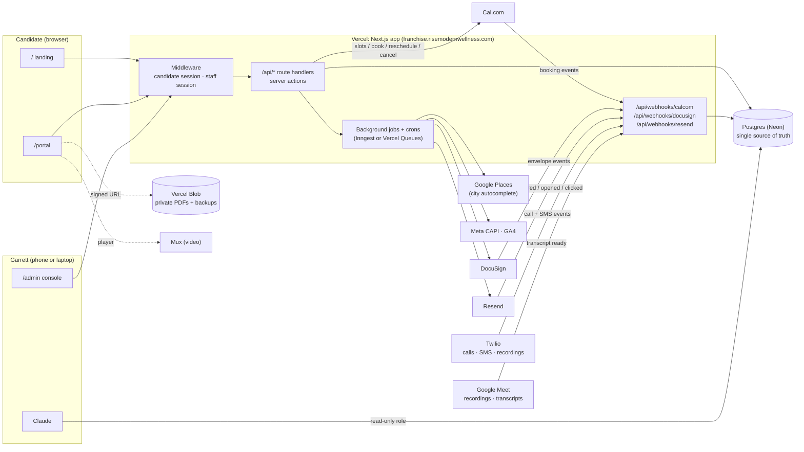
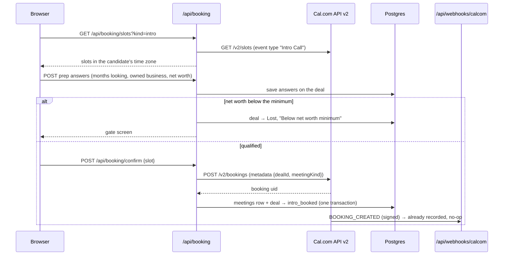

# RISE Franchise Portal — Architecture Blueprint

**Domain:** `franchise.risemodernwellness.com`
**Repo:** `rise-franchise-portal` (new, private). See §13.
**Source designs:** canvas "RISE Franchise Landing Page Mockup". Boards `Main` (landing + opt-in), `Territory-Report` (availability result + intro-call booking; scoring/census content cut, §11A.3), `Sales-Portal` (candidate portal).
**Systems:** one Next.js app on Vercel, one Postgres database (Neon), Cal.com + Google Meet, an e-sign provider, Resend (email), Twilio (calls + SMS), Inngest (automations), Mux (course video).
**Revised:** 2026-11-06. This version drops Pipedrive as the store of record (§2). Earlier versions are in git history on this branch.

---

## 1. The decisions, in one page

| Question | Decision | Why |
|---|---|---|
| Where to host | **Vercel, running one Next.js (App Router) app** | Static landing page, per-user portal pages, the admin console, API routes, webhooks and crons in one deploy. A preview URL for every branch. |
| How many apps | **One app, one domain, two sides.** Candidate side at `/`, `/portal`. Admin side at `/admin`. | Both sides read the same data and share one design system. Splitting front end and back end into separate repos would add a deploy boundary with nothing to gain. |
| Where data lives | **One Postgres database owns everything.** No CRM behind it. | The portal needs its own database anyway (tokens, bookings, homework, video progress, events, legal records). Pipedrive could only hold the stage and some summary fields, so keeping it meant two databases plus sync code forever. See §2. |
| How Garrett works | **The admin console, mostly on his phone, during the call.** Each meeting has one screen: prep, capture, outcome, book the next meeting. | He doesn't use CRM screens. The console writes every input to the right place. |
| How Garrett gets answers | **He asks Claude.** Claude reads the database through a read-only role and reporting views (§9). | "Where is Jane and how long has she been there?" is a query, not a dashboard. |
| How the candidate is identified | **Opaque signed token in the link + session cookie. Never a raw ID.** | IDs are sequential; changing the number would expose another candidate. |
| How the admin side is protected | **Google sign-in, limited to `@risemodernwellness.com` accounts on an allow list** | Admin URLs can use plain IDs (`/admin/meetings/812`) because nobody without a staff login can open them. |
| Calendar | **Cal.com API v2 behind our own UI**, plus Cal.com webhooks | Our own picker on both sides. Cal.com still sends invites and reminders and syncs with Garrett's calendar. |
| Compliance proof | **Append-only history tables from day one** (stage history, audit log, legal records) | This replaces the change log a CRM would give for free. The FDD receipt and the 14-day clock must be provable. |

---

## 2. Why no Pipedrive (decided 2026-11-06)

Pipedrive's data model is deals, people, organizations, activities and notes. It has no custom record types. Against what this portal needs:

| Need | In Pipedrive |
|---|---|
| Stages, time in stage, won/lost | Fine |
| One-value facts (net worth band, FDD date) | Fine, as custom fields |
| Homework answers | Notes only. Not searchable or reportable. |
| Meeting outcome (held / no-show), prep sheet | Activities are only done / not done |
| Bookings, video and PDF progress, tokens, events | Nowhere |
| Territories as records (ZIPs, shape, open/reserved/sold) | Text on a deal only |
| FDD receipt as a legal record | A date, not proof |
| Lost-reason list | Settings screen only; not in the API |

With Pipedrive kept, about a third of the system was sync: two-way webhooks, a nightly reconcile, an outbox, echo guards, a daily API budget, field-ID config. One database removes all of it.

**What we give up, and how we cover it:**

| Pipedrive gave us | Covered by |
|---|---|
| Per-record change log | `audit_log` + `deal_stage_history` (§8) |
| Gmail sync onto the deal | Portal-sent emails are logged in `emails`. Garrett's own Gmail threads are not. Open question Q9. |
| A board to look at | `/admin` pipeline list, plus asking Claude |
| Mobile app | The admin console is mobile-first |
| 460 deals of history | One-time import (§12) |

**Transition.** The old "Franchise Lead Flow" funnel keeps running in Pipedrive until its open deals close. New candidates go only into the portal. Then history is imported once and the seat is cancelled. The Pipeline 2.0 stages set up in Pipedrive on 2026-11-06 are only a reference; the stage list now lives in the app (§5).

---

## 3. System map



**Rule of thumb:** every screen reads from and writes to our database in the request. Slow or failure-prone side effects (email, Meta conversions, DocuSign envelopes) go to a background job that retries. Nothing the candidate or Garrett does waits on a third party, except booking, which needs Cal.com's answer.

---

## 4. Routes

### 4.1 Candidate side

| Route | Rendering | Who | Built from |
|---|---|---|---|
| `/` | Static (ISR), edge-cached | Public | `Main.dc.html` |
| `/r/[token]` | Server redirect | Magic link from email | Sets the cookie, redirects to `/portal` (honors `?to=` and `?src=`) |
| `/portal` | Dynamic, `no-store` | Candidate session | `Territory-Report.dc.html` + `Sales-Portal.dc.html` |
| `/portal/chapter/[key]` | Dynamic | Candidate session, chapter unlocked | Chapter view |

**`/portal` is the only candidate URL.** What it renders depends on the deal's stage:

- **Territory Check** → availability result ("Available" / "Already taken", §11A.3) + Intro Call booking (the `Territory-Report` board, trimmed)
- **Intro Call Booked** → availability result + "your call is booked" card with reschedule / cancel
- **Meeting 1 Booked** and later → the chapter portal (the `Sales-Portal` board), §5.3

One bookmark, and one link in every email.

### 4.2 Admin side

| Route | What it is |
|---|---|
| `/admin` | Today: meetings today and tomorrow, stalled deals, homework waiting to be read |
| `/admin/pipeline` | All open deals by stage, with days in stage. List on mobile, board on desktop. |
| `/admin/deals/[id]` | One deal: timeline (stage changes, meetings, homework, notes, emails), fields, Mark Lost |
| `/admin/meetings/[id]` | **The call screen** (§6). Opened from the link in the calendar invite. |
| `/admin/settings` | Lost reasons, staff allow list, email schedule on/off |

---

## 5. The pipeline

### 5.1 The rule: stage or data?

**A stage is a place a deal waits.** Add one only when all four are true:

1. Deals can sit there for days (time in stage means something).
2. A different next action is owed: by the candidate, by Garrett, or by the calendar.
3. We want drop-off reported at that point.
4. The portal shows the candidate something different there.

Everything else is data:

| Kind of fact | Where it lives |
|---|---|
| An event's outcome (held, no-show) | `meetings.status` |
| When a milestone happened | A timestamp column on `deals` or a row in `legal_records` |
| A checklist inside a stage | `progress` rows + `homework` rows |
| A qualification | A column on `deals` |
| Something Garrett said or noticed on a call | `meeting_captures` (structured) or `notes` (free text) |

"Showed" fails test 1: Garrett books the next meeting live, so a "showed" stage would hold a deal for seconds. Separate pre-work stages fail for the same reason: the candidate does the pre-work while booked for the next meeting.

### 5.2 Stages (decided)

Each "Booked" stage means **the next thing on the calendar is this meeting, and it hasn't happened yet.** Booking the next meeting moves the deal, whoever books it.

The stage list is a typed constant in code (`lib/stages.ts`). Deals store `stage_key`. Renaming a stage's label never touches data.

| # | `stage_key` | Label | Before this meeting the candidate… | Chapter | Entered by |
|---|---|---|---|---|---|
| 1 | `territory_check` | Territory Check | Sees their city is available, is prompted to book | 1 · Your territory | Opt-in |
| 2 | `intro_booked` | Intro Call Booked | Nothing. No homework before the intro. | 1 · Your territory | Booking |
| 3 | `m1_booked` | Meeting 1 Booked · Business Overview | Video 1 (marketing, sales, delivery) + homework | 2 · The business | Booking |
| 4 | `m2_booked` | Meeting 2 Booked · Marketing | Video 2 + homework | 3 · Marketing | Booking |
| 5 | `m3_booked` | Meeting 3 Booked · Sales | Video 3 + homework | 4 · Sales | Booking |
| 6 | `m4_booked` | Meeting 4 Booked · Delivery | Video 4 + homework. **FDD delivered here** (DocuSign receipt; 14-day clock starts). | 5 · Delivery | Booking |
| 7 | `m5_booked` | Meeting 5 Booked · Leadership | Video 5 (how the three run together) + homework + FDD questions | 6 · Leadership | Booking |
| 8 | `territory_booked` | Territory Meeting Booked | Territory preferences, proof of funds | 7 · Your territory, for real | Booking |
| 9 | `preconf_booked` | Pre-Confirmation Meeting Booked | Validation calls with current owners | 8 · Confirmation Day | Booking |
| 10 | `confday_booked` | Confirmation Day Booked | Agenda, travel, who they'll meet | 8 · Confirmation Day | Booking |
| 11 | `preparing_award` | Preparing To Accept Award | Agreement review with an attorney | 9 · Award | Garrett (console) |
| 12 | `agreement_signed` | Franchise Agreement Signed | DocuSign agreement. **Unlocks only 14+ days after FDD receipt.** | 9 · Award | DocuSign webhook |
| 13 | `fee_collected` | Franchise Fee Collected → **Won** | Also blocked until 14+ days after FDD receipt | 10 · Welcome to RISE | Garrett (console) |

A deal is also `open`, `won` or `lost` (`deals.status`). Won happens at stage 13. Lost can happen at any stage.

Each stage entry in `lib/stages.ts` carries: `key`, `order`, `label`, `chapter`, `meetingKind` (the meeting that stage is waiting on, if any), `stalledAfterDays` (§5.5), and `gate` (for example the 14-day FDD rule on stages 12–13).

Each meeting kind is its own Cal.com event type: `intro`, `m1`…`m5`, `territory`, `preconf`, `confday`.

### 5.3 What happens at each meeting

```text
Deal in "X Booked" ──(call happens)──► Garrett marks meeting X: Held
   │                                        │
   │                             Garrett books meeting Y on the call screen
   │                                        ▼
   │                             deal → "Y Booked" (same request)
   │
   ├─(no-show)──► meeting X = No-show. Portal + email: "Pick a new time" (same meeting X).
   │              Deal stays in "X Booked".
   │
   └─(held, nothing booked yet)──► deal stays in "X Booked", meeting X Held.
                  Shows as stalled after N days (§5.5). Portal shows "Book your next meeting".
```

- **Bookings made outside the app** (Garrett books straight in Cal.com) still work. The Cal.com webhook matches the attendee email to the candidate's open deal and moves it.
- **Homework gate:** the portal shows that meeting's video and homework. Homework is due 24h before the meeting, with reminders at 72h and 24h. The meeting is **not** blocked by missing homework; Garrett decides on the call screen whether to hold or reschedule.
- **The portal reads one thing to decide the chapter:** the stage. Everything finer comes from `progress` and `homework`.

### 5.4 Deal lifecycle rules (decided)

The **candidate** (a person) is permanent. A **deal** is one attempt to move that person through the pipeline.

1. **Opt-in while a deal is open:** no new deal. Add a note to the open deal ("Re-checked <city, state> on <date>"). Update the city only if no Territory Meeting has been held yet.
2. **Opt-in when every earlier deal is won or lost:** create a new open deal in `territory_check`. The old deal stays in history.
3. **Net-worth gate fails** (Intro Call prep questions): deal → **Lost**, reason **"Below net worth minimum"**. No nurture stage. The candidate stays on file; nurture email segments on candidate + lost reason + last stage reached.
4. **14-day booking window:** a deal in `territory_check` for 14 days with no Intro Call booked → **Lost**, reason **"No response"**.
   - **Clock:** starts when the deal enters `territory_check`, from `deals.stage_entered_at`. For a new deal that's the opt-in. For a cancelled Intro Call that sent it back, it's the day it moved back.
   - **Enforced by** a nightly cron (`/api/cron/stale-deals`). Any booking stops the clock, because booking moves the deal out of the stage.
   - **Warning:** the deal shows as stalled on day 10 (`stalledAfterDays: 10`), so Garrett sees it before the cron closes it.
   - **Value-first follow-up emails** go out during the window, suggested days 2, 5, 10 and 13. Each teaches something first and asks for the booking second. Example topics: what the territory's numbers mean, Rachel's story, how a RISE location ramps, what really happens on the Intro Call.
     - Every email links to the booking section of the candidate's portal: `/r/<token>?to=book&src=email-<n>`.
     - Sending stops the moment a call is booked or the deal closes. The job checks the stage right before each send.
     - `emails` + `events` record sent, opened and clicked. A booking made after an email click is credited to that email.
     - Copy lives in `content/emails/`.
5. **Re-opt-in by an owner** (a candidate with a won deal): rule 2 still applies, and the app flags it for Garrett, because an existing owner shouldn't go through the stranger funnel.

**Lost reasons are a fixed list** in `lost_reasons`, editable in `/admin/settings`. No free text; there's an optional comment beside the reason. Starting list, mapped to how deals were actually lost in Pipedrive:

| Reason | Was in Pipedrive as |
|---|---|
| No response | "Did Not Respond" (210) |
| Not a fit | "Poor Culture Fit" (77) |
| Lost interest | "Lost Interest" (50), "Responded - Lost Interest" |
| Below net worth minimum | — |
| Below liquidity minimum | "Lack Of Financials" |
| Not ready yet (timing) | "Too early in research mode", "Needed more time…" |
| Territory unavailable | "Bad territory", "No territory available", "Overlapping territories" … |
| Registration state | "Not registered in state", "Lives in a registration state" |
| Chose another brand | — |
| Not a real lead | "Fake contact info", "Wrong number", vendor pitches |

### 5.5 Stalled deals

There's no CRM rotting, so the app computes it. A deal is **stalled** when it has been in its stage longer than that stage's `stalledAfterDays` **and** has no future meeting booked. Stalled deals show at the top of `/admin`, and Claude can list them. Values per stage are open question Q7; `territory_check` is 10.

### 5.6 Compliance gates (enforced in code)

1. **FDD receipt is a legal record.** The DocuSign receipt writes an immutable `legal_records` row (FDD version, SHA-256, signed_at, IP) and sets `deals.fdd_receipt_signed_at`.
2. **14 calendar days.** Stages 12 and 13 can't be entered, and the agreement chapter can't unlock, before `fdd_receipt_signed_at + 14 days`. The check lives in one function used by the portal, the console and the webhook handler.
3. **Old FDD version.** If a returning candidate's receipt is for an older FDD, they get the current one and the clock restarts.
4. **Registration states.** If the territory is in a registration state where RISE isn't registered, the FDD and agreement chapters show a "we'll be in touch" view. State list in config.
5. **Agreement signing** goes through DocuSign, not typed-name signing.
6. **Financial-performance content** ("Sample P&L", "Item 19 summary") gets counsel review so it matches Item 19.
7. **Proof of funds** uses a secure-link approach; bank statements are never stored. Net worth and liquid capital columns are encrypted at rest and never written into `events`.
8. **Privacy.** A consent banner gates ad pixels; the opt-in form links the privacy policy.

---

## 6. The admin console

The console is how data gets in. Garrett takes most calls from his phone, so every screen is built mobile-first.

### 6.1 Getting to the call screen

- When a meeting is booked (by the candidate, by Garrett on the console, or straight in Cal.com), the app writes the meeting's admin link into the Cal.com booking's private notes: `https://franchise.risemodernwellness.com/admin/meetings/<id>`. That link shows in Garrett's calendar event, so he taps it from his phone's calendar.
- About 24h before each meeting, a job marks the prep ready and (optional, Q10) sends Garrett a push or Connecteam DM with the same link.
- Plain IDs are fine here because every `/admin` route requires a staff session.

### 6.2 The call screen (`/admin/meetings/[id]`): one layout for every meeting (decided)

**Build the UX once.** Like the candidate portal, the call screen has the same regions on every call; only the content changes per meeting kind (§6.3). Top to bottom, in the order of the call:

1. **Header:** candidate name, territory, stage, days in pipeline, meeting kind and time. Tap to call (Twilio, §7A.3), tap to text, tap to email, **Join Meet**.
2. **Timer:** counts down from the booked length. Amber at 5 minutes left, red when over. Starts on "Start call" or at the booked time. The actual length is saved on the meeting (`duration_min`).
3. **Agenda:** that meeting's talking points, ticked off as the call goes.
4. **Their work (prep):** that meeting's homework answers; video watched (yes/no, %); FDD opened (from Meeting 4 on); portal activity since the last call; last call's summary and notes.
5. **Capture:** the inputs defined for this meeting kind. Each writes straight to its column or to `meeting_captures`. Autosaves on every change, so a dropped call or a closed tab loses nothing. After the call, fields Claude pre-filled from the transcript show as "suggested" until Garrett confirms them (§7A.4).
6. **Notes:** one free-text box (dictation-friendly on mobile). Saved as a note on the meeting.
7. **Outcome:** `Held` / `No-show` / `Reschedule`. No-show bumps the count and triggers the "pick a new time" email.
8. **Decision + book next:** the meeting's decision options and the Cal.com picker for the next meeting kind, inline. Picking a slot books it, moves the deal and sends the invite. This is always the last step of a call.
9. **Close out:** `Mark Lost` (reason from the fixed list + optional comment) and, on later stages, `Preparing award` / `Fee collected`.

### 6.3 What changes per meeting

Each meeting kind has one entry in `content/meetings.ts`: **length, agenda, which homework to show, capture inputs, decision options and next meeting.** The call screen, the prep section, the Claude views and the Cal.com event type length all read from it. Adding or changing a meeting is a config edit, not a new screen. **Filling these in, meeting by meeting, is the next design step (Q1).** Shape:

```ts
export const meetings = {
  intro: {
    label: 'Intro Call',
    lengthMin: 20,                       // draft
    agenda: ['Their why', 'Background', 'RISE in two minutes', 'Money check',
             'Territory and timing', 'Questions', 'Decide and book Meeting 1'],  // draft
    homework: null,                      // no homework before the intro
    decisions: ['advance', 'not_a_fit', 'not_now', 'think_it_over'],
    nextKind: 'm1',
    captures: [
      { key: 'net_worth_verified', label: 'Net worth confirmed on call', type: 'boolean', writes: 'deals.net_worth_verified' },
      { key: 'why_now',            label: 'Why now?',                    type: 'text',    writes: 'meeting_captures' },
      { key: 'decision_makers',    label: 'Who else decides?',           type: 'text',    writes: 'meeting_captures' },
      // …
    ],
  },
  m1: { label: 'Meeting 1 · Business Overview', nextKind: 'm2', homeworkForm: 'm1-v1', captures: [ /* … */ ] },
  // m2…m5, territory, preconf, confday
} satisfies Record<MeetingKind, MeetingDef>;
```

Rule for `writes`: if it's a **fact** we'll filter or gate on (net worth, proof of funds, territory), it's a column on `deals`. If it's **what was said**, it's a `meeting_captures` row, keyed by `capture_key`, so it's still queryable ("show me every 'why now' answer").

**Intro Call draft** (pending Garrett's agenda, Q1): captures net worth confirmed, liquid capital band, funding plan, owner-operator vs investor, decision makers, target open, territory confirmed (all `deals` columns); "why now", background, concerns (`meeting_captures`). The long vision / five-year / financial-metrics questions from the old Pipedrive application move to Meeting 1 homework.

---

## 7A. Communications: email, automations, SMS, calls, meeting recordings

### 7A.1 Automations (decided: built in, not bought)

Anything Pipedrive's automations did, plus triggers Pipedrive couldn't see (portal inactivity, video %, homework status, email clicks). Each automation is a rule in `content/automations.ts`, with copy in `content/emails/`:

| Part | Examples |
|---|---|
| **Trigger** | Entered a stage · marked Lost (with reason) · N days in stage · N days inactive in the portal · homework due in 72h and not submitted · meeting was a no-show · meeting in 1h |
| **Condition** | Lost reason is X · no meeting booked · not unsubscribed · email not bounced |
| **Action** | Send email N · send SMS · notify Garrett |
| **Stop when** | Books · stage changes · deal closes · unsubscribes |

- **Runs on Inngest** (durable steps: wait N days, re-check, send; cancel on a "booked" or "stage changed" event). Every action re-checks the stop conditions right before it fires.
- Each automation has an on/off switch in `/admin/settings`. Rules change by editing the file (Garrett asks Claude), not in a visual builder.
- The 14-day follow-up emails (§5.4) are the first automation. Example of a second: Lost from `territory_check` with "No response" → wait 30 days → value-first territory insight → wait 60 days → next one → stop on re-opt-in or unsubscribe.
- **Before launch:** inventory the automations live in Pipedrive today and rebuild each one deliberately (Q13).

### 7A.2 Email deliverability

1. Send from a **subdomain** (e.g. `garrett@mail.risemodernwellness.com`) through **Resend**, so its reputation is separate from the main Google Workspace domain.
2. **SPF, DKIM and DMARC** on that subdomain before the first send.
3. Emails **from Garrett**, mostly plain text, one link, no heavy templates.
4. **One-click unsubscribe** (`List-Unsubscribe` header) and a physical address on every nurture email. Transactional mail (magic links, booking confirmations) doesn't carry it.
5. Bounces and complaints come back by webhook and go on a **suppression list** at once.
6. **Reply-to is Garrett's Gmail.** Replies land where he works and help sender reputation.
7. Ramp gradually. Never blast the imported Pipedrive list.

`emails` gains `kind ('transactional'|'nurture')`, `bounced_at`, `complained_at`; `candidates` gains `email_unsubscribed_at`, `sms_consent_at`, `sms_unsubscribed_at`.

### 7A.3 SMS and calls (Twilio)

- **Its own Twilio sub-account and number**, separate from RISE OS.
- **Click-to-call:** Twilio rings Garrett's phone, then bridges the candidate, with the RISE franchise number as caller ID. Calls are recorded; the recording and length attach to the meeting (or to a `calls` row when no meeting exists).
- **Recording notice** at the start of every phone call ("This call may be recorded"), because about a dozen states (California and Florida among them) require all-party consent.
- **Two-way SMS**, logged on the deal timeline, usable by automations (for example a reminder 1h before a call). STOP replies set `sms_unsubscribed_at`.
- **Before SMS goes live:** A2P 10DLC carrier registration (about 1–2 weeks), and an SMS consent checkbox on the opt-in form, in the landing page design now.

New table: `messages (id, deal_id, channel 'sms', direction, body, twilio_sid, at)` and `calls (id, deal_id, meeting_id null, direction, twilio_sid, started_at, duration_s, recording_url, transcript_id null)`.

### 7A.4 Video calls: Google Meet + transcripts (decided: stay on Meet)

```text
Booking (Cal.com, Google Meet as location) → Calendar event with Meet link
  → meetings.meet_url stored; call screen shows "Join Meet"
Call in Meet with recording + transcript on
  → Google Workspace Events API notifies the app that the transcript is ready
  → app pulls transcript + recording link via the Meet REST API
  → Claude writes a summary + suggested capture values
  → Garrett confirms them on the call screen
```

- Needs Meet recording and transcripts, which come with **Google Workspace Business Standard or higher** (Q14). On Business Starter, the fallback is a note-taker bot (Fireflies or Recall.ai) feeding the same `transcripts` table.
- One-time Google OAuth consent from Garrett's account (read-only scopes for his meetings' recordings and transcripts).
- **Phone calls** use the same pattern: Twilio recording → transcription service (about $0.25–0.50 per audio hour) → `transcripts`.
- No in-app video (Daily, LiveKit): candidates keep the Meet link they know, and we don't own video quality.

New table: `transcripts (id, meeting_id null, call_id null, source 'meet'|'twilio'|'bot', text, recording_url, summary, suggested_captures jsonb, created_at)`.

### 7A.5 Video hosting for the course

- **Mux** for portal course videos: our player sends progress to `/api/progress`, so watch data lives in our database whatever the host. Mux's free plan should cover the 5 course videos plus extras; check current limits at sign-up.
- **Loom stays** for one-off and internal videos. It doesn't carry portal watch tracking.

### 7A.6 Running cost (estimates at list price, check at sign-up)

| Tool | For | Est. / month |
|---|---|---|
| Vercel | Hosting | $0 extra (existing Pro team) |
| Neon | Database | $0–20 |
| Inngest | Automations | $0 |
| Resend | Email | $0–20 |
| Cal.com | Booking (API access must be on the plan) | $0–15 |
| Mux | Course video | $0–20 |
| Twilio | Calls, SMS, recording, carrier registration | $10–30 |
| Transcription | Phone calls | ~$1–5 |
| E-sign (API) | FDD receipt + agreement | **$25–300: the swing item** (Q15) |
| Sentry, Google Places, Turnstile, Meta CAPI, PostHog | | $0 on free tiers |

Roughly **$40–100/month before e-sign**. Pipedrive (about $70) replaced none of these; dropping it adds only email sending and automations. The real ongoing cost is upkeep time (updates, deliverability, backups), kept low by buying the hard parts (email sending, e-sign, calendar, video, telephony, sign-in) and building only the CRM layer.

---

## 7. Identity and auth

### 7.1 Candidates

1. **On opt-in** the server upserts `candidates` by email, opens or reuses a deal (§5.4), and sets a signed, httpOnly cookie (`rise_session`). The candidate goes straight to their availability result.
2. **The confirmation email** carries a magic link `/r/<token>`. The token is 32+ random bytes; only its hash is stored in `portal_tokens`, with an expiry. It's reusable until it expires or is revoked. Every email carries a fresh one. Clicking it sets the cookie and marks the email **verified**.
3. **Two trust levels.** *Unverified* (just submitted the form): availability result and Intro Call booking. *Verified* (clicked an emailed link): everything sensitive, including financials, FDD, application, agreement.
4. **New device:** "Send me my portal link" emails a fresh magic link. No passwords.

### 7.2 Staff

- Google sign-in (Auth.js), limited to `@risemodernwellness.com` and to emails on `staff_users`.
- **No roles for now (decided):** Garrett and Rachel share one login, `admin@risemodernwellness.com`, with full access. Every write still records `actor_staff_id` in `audit_log`, so roles can be added later without losing history.
- **View as candidate:** `/portal?as=<candidateId>` works only with a staff session. Build when needed.

---

## 8. Data model (Postgres, Drizzle)

```text
candidates         id uuid pk, email citext unique, first_name, last_name, phone,
                   created_at, last_active_at, email_verified_at,
                   pipedrive_person_id null                       -- legacy link, §12
deals              id serial pk, candidate_id fk, status ('open'|'won'|'lost'),
                   stage_key, stage_entered_at, opened_at, closed_at,
                   lost_reason_id fk null, lost_comment,
                   lead_source, attribution jsonb (utm_*, fbclid, gclid, referrer, landing),
                   city, state, place_id,
                   months_looking int, owned_business_before bool, business_name,
                   net_worth_meets_min bool, net_worth_band, liquid_meets_min bool,
                   liquid_capital_band (bands encrypted), net_worth_verified bool,
                   funding_plan, target_open,
                   fdd_sent_at, fdd_receipt_signed_at,
                   proof_of_funds_verified_at, validation_calls_done int,
                   ready_for_review bool, no_show_count int,
                   source ('portal'|'pipedrive_import'), legacy_stage_label null,
                   pipedrive_deal_id null
deal_stage_history id, deal_id, from_stage, to_stage, at, actor ('candidate'|'staff'|'system'),
                   actor_staff_id null, cause ('booking'|'cancel'|'console'|'docusign'|'cron')
                   -- append-only; time in stage and drop-off come from here
lost_reasons       id, label, active bool, sort
meetings           id serial pk, deal_id, kind ('intro'|'m1'…'m5'|'territory'|'preconf'|'confday'),
                   cal_uid unique, start_at, end_at, tz, meet_url, booked_by ('candidate'|'staff'|'cal_direct'),
                   status ('booked'|'held'|'no_show'|'cancelled'|'rescheduled'),
                   held_at, duration_min, stage_before_booking, prep_ready_at
meeting_captures   id, meeting_id, deal_id, capture_key, value jsonb, author_staff_id, at
notes              id, deal_id, meeting_id null, body, author ('staff'|'system'), at
homework           id, deal_id, meeting_kind, form_version, answers jsonb,
                   submitted_at, read_at null
progress           deal_id, chapter_key, step_key, status, pct, completed_at
                   (pk: deal_id + chapter_key + step_key)
legal_records      id, candidate_id, deal_id, kind ('fdd_receipt'|'agreement'),
                   document_version, document_sha256, envelope_id, signed_name,
                   signed_at, ip, user_agent                       -- immutable
taken_territories  id, city, state, store_name null, note, added_at, added_by   -- the ~33 sold; §11A.3
emails             id, deal_id, template, n, sent_at, provider_id, opened_at, clicked_at
events             id bigserial, candidate_id null, anon_id, deal_id null, name, props jsonb,
                   path, ts                                        -- append-only
portal_tokens      id, candidate_id, token_hash, purpose, expires_at, used_at
staff_users        id, email, name, role, active
audit_log          id, at, actor ('staff'|'candidate'|'system'), actor_staff_id null,
                   entity, entity_id, field, old jsonb, new jsonb   -- append-only
```

**Rules:**

- Every change to `deals` goes through one module (`lib/deals.ts`) that writes `audit_log` and, for stage changes, `deal_stage_history` in the **same transaction**. No other code updates `deals` directly.
- `audit_log`, `deal_stage_history`, `legal_records`, `events` and `homework` are append-only. The app's database role has no `UPDATE`/`DELETE` on them.
- A candidate's portal always follows their **newest** deal. Progress is per deal, so a returning candidate starts fresh. Legal records are kept forever.
- Backups: Neon point-in-time restore, plus a nightly logical dump to private Blob storage.

---

## 9. Claude as the reporting UI

Garrett asks questions instead of opening dashboards. To make that safe and reliable:

- **A read-only database role** (`claude_ro`) with `SELECT` on reporting views only, not on raw tables with encrypted or token columns.
- **Reporting views** so questions map to one query:
  - `v_pipeline` — open deals with stage label, days in stage, next meeting, stalled flag
  - `v_candidate_timeline` — everything that happened to one candidate, in order
  - `v_meeting_outcomes` — show rate by meeting kind, by week
  - `v_funnel` — counts entering each stage and lost from each stage, by lost reason, by lead source
  - `v_homework` — submitted/missing per upcoming meeting
  - `v_email_performance` — sends, opens, clicks, bookings credited per follow-up email
- **Connection:** a Postgres MCP connector on Garrett's Claude, pointed at the `claude_ro` connection string. Claude reads; every write goes through the console.
- Example questions: "Who's stalled?", "Where's Jane at and how long has she been there?", "What did everyone say for 'why now' on intro calls this month?", "Show rate on Meeting 3 since September?"

---

## 10. Cal.com

### 10.1 Booking flow on the candidate side (`Territory-Report` board)

Mockup order: **pick slot → prep questions → net-worth gate → confirm.**



The admin call screen books the same way (§6.2 step 6), with `booked_by = 'staff'`.

- **Time zones:** detect the browser's zone and send it with slot and booking requests. The mockup's hard-coded Central Time goes.
- **Metadata:** every app-made booking carries `dealId` and `meetingKind`. The webhook never has to guess for those.
- **Fallback:** if the custom picker slips the schedule, launch with the Cal.com inline embed (prefilled name and email; prep questions asked first in our UI). The webhook logic doesn't change.

### 10.2 Webhook (`/api/webhooks/calcom`)

Verifies `X-Cal-Signature-256`, then:

| Trigger | Action |
|---|---|
| `BOOKING_CREATED` | If the `cal_uid` already exists, no-op. Otherwise (booked straight in Cal.com): match the attendee email to the open deal, map the event type to a meeting kind, insert `meetings`, move the deal to that kind's "Booked" stage. Write the admin link into the booking. |
| `BOOKING_RESCHEDULED` | Update the times on the same `meetings` row |
| `BOOKING_CANCELLED` | Mark cancelled; move the deal back to `stage_before_booking` |
| `MEETING_ENDED` | If Garrett hasn't set an outcome within 2h, flag the meeting on `/admin` ("outcome missing"). Never auto-move. |

Handlers are idempotent by `cal_uid` + trigger, so retries are harmless.

### 10.3 "Next meeting" card (`Sales-Portal` board)

Reads the next future, non-cancelled `meetings` row. No Cal.com call on page load. Menu: **Reschedule** (our picker → `POST /v2/bookings/{uid}/reschedule`), **Cancel** (with a reason), **Add to calendar** (`.ics`).

---

## 11. Candidate portal engine

One pure function used by the page (to render), the API (to enforce) and the console (to preview):

```ts
computePortalState({
  stageKey, dealStatus,       // from deals
  progress, homework,         // from the DB
  nextMeeting,                // from meetings
  fddReceiptSignedAt,         // for the 14-day gate
  verified,                   // email verified?
}) => {
  view: 'available' | 'booked' | 'portal' | 'gate' | 'closed' | 'owner',
  currentChapter,             // 1..10
  chapters: [{ key, status: 'done' | 'now' | 'locked', steps: [...] }],
  nextAction,                 // "Watch: Meeting 2 video"
}
```

- **Chapter content lives in config** (`content/chapters.ts`), shaped like the `STAGES` array in the `Sales-Portal` board: videos, PDFs, decks, homework forms, extra resources. Move to a CMS only once non-developers edit it every week.
- **The stage is the ceiling.** A candidate can never see past their deal's stage.
- **Progress is the floor within a chapter.** Steps unlock in order.
- **The server decides "complete."** A video counts only after progress events covering ≥90% of its length; a PDF only after the last page.
- **Media:** Mux for video (player reports time watched). PDFs through PDF.js in our own viewer, from private Blob storage via short-lived signed URLs.

---

## 11A. Content, forms and assets (decided 2026-11-06)

### 11A.1 No upload screen: content is code

There's no admin UI for content. Garrett, or anyone with repo access, hands Claude the file and says where it goes. Claude uploads it, updates the content file and opens a pull request. The preview deploy shows the change; merging publishes it.

| Asset | Lives in | Added by |
|---|---|---|
| Course videos | Mux | `scripts/upload-video.ts` → Mux playback ID written into `content/chapters.ts` |
| PDFs, decks, worksheets | Private Vercel Blob | `scripts/upload-asset.ts` → entry in `content/assets.ts` (id, title, blob key, sha256) |
| FDD | Private Vercel Blob, **versioned** | `scripts/upload-asset.ts --fdd <version>`. A new FDD is a new version, never a replaced file, so every `legal_records` row keeps pointing at the exact document received. `content/assets.ts` marks which version is current. |
| Photos, logos | `public/` (compressed to web size first; source exports are 12–21 MB) | Committed |
| Words: chapter text, agenda items, email copy | `content/*.ts`, `content/emails/` | Edited directly |

### 11A.2 One form engine for homework, call captures and booking questions

Every form is a versioned definition in `content/forms/` (e.g. `m2-homework@3`). Supported question types: short text, long text, single choice, multiple choice, number, percent, slider, rating scale, date, fill-in-the-blank. New types are added to the engine once and are then available everywhere.

- **Answers** are stored as `jsonb` keyed by question id, with the form key and version (`homework.form_version`, `meeting_captures` per capture key). Adding or changing a question is a content edit plus a version bump; no migration. Old answers keep the version they were given against.
- The same engine renders candidate homework (portal), Garrett's capture fields (call screen) and the booking questions (Intro Call booking).
- A capture that's a **fact** still writes to its `deals` column (§6.3 rule); the form definition says which.

### 11A.3 Territories: a simple yes or no (decided 2026-11-06)

**We sell RISE, not a territory score.** No census data, scoring or territory maps; they add noise and carry their own legal risk. The candidate gets a binary answer.

- **Input:** one location field with Google Places Autocomplete, limited to US cities (`types: ['(cities)']`). The candidate can type a city or a ZIP, but must pick a city from the suggestions. We store only **city + state** (plus the Google place id): `deals.city`, `deals.state`, `deals.place_id`.
- **Taken list:** `taken_territories (id, city, state, store_name null, note, added_at, added_by)`, starting with the ~33 territories already sold. Garrett can add or remove rows in `/admin/settings → Taken territories`, or ask Claude. When a deal is **Won**, its city is added automatically.
- **Lookup:** case-insensitive match on city + state. Match → "Already taken" (with a soft next step to look at a nearby city or talk to Garrett). No match → "Available". Houston shows as available even though part of it has a store; which part is open is covered on the calls.
- **Not now:** filtering out cities too small to qualify. Revisit only if it becomes a real problem.
- The defined territory itself (ZIPs, boundaries) is set at the Territory Meeting and recorded in the franchise agreement, not in the app.

### 11A.4 Qualification data (schema decided, order pending)

The schema stores both a yes/no and a band, so the question order can change without a migration: `net_worth_meets_min bool`, `net_worth_band`, `liquid_meets_min bool`, `liquid_capital_band`. Proposed order (Q8): opt-in = name, email, city; booking = phone + SMS consent + the two yes/no questions; Intro Call = exact bands.

### 11A.5 Data retention (decided)

- Candidates whose every deal is lost: personal details are anonymized **3 years** after the last deal closed (nightly `cron/retention`).
- `events`: deleted after **3 years**.
- `legal_records` and the FDD versions they point at: kept indefinitely.
- Deletion requests: everything except legal records, logged in `audit_log`.

---

## 12. Pipedrive transition

| Step | When | What |
|---|---|---|
| 1. Import people | Before launch | Import Pipedrive persons into `candidates` (`pipedrive_person_id` set), so a returning old-funnel lead is recognized at opt-in instead of looking new. |
| 2. Run both | Launch → last old deal closes | New candidates: portal only. Old "Franchise Lead Flow" deals finish in Pipedrive. Whatever creates new deals in Pipedrive today (the current lead form or automation) is switched to the portal's opt-in at launch. |
| 3. Import history | When no old deals are open | Import all Pipedrive deals as `source = 'pipedrive_import'`, `status` won/lost, old stage name in `legacy_stage_label`, free-text lost reason mapped to the fixed list (§5.4) with the original kept in `lost_comment`. Import notes. |
| 4. Cancel | After a spot-check | Export a full backup of Pipedrive to Blob, then cancel the seat. |

The import is a one-off script (`scripts/import-pipedrive.ts`) using the existing API token. No live sync is ever built.

---

## 13. Repo and deploy

### 13.1 Its own repo (decided)

**New private repo `rise-franchise-portal`** (or reuse the empty `fran-sales` repo, renamed). Not inside `rise-hub`, `automations-hub` or this repo:

- **Different users and data.** Candidates are outside prospects with financial data and legal records. `rise-hub` serves staff behind a shared password. Mixing them widens who can reach what.
- **Different release pace and risk.** A bad deploy here shouldn't touch the staff hub, and the reverse.
- **Unrelated to RISE OS.** Franchise development is its own business line with its own domain.
- **One repo, not two.** Front end and back end stay together: in Next.js the API routes, server actions, webhooks and crons deploy with the pages. Splitting them would mean two deploys, shared types copied across, and CORS, for no benefit at this scale.

What to borrow from `rise-hub`: the RISE design tokens, Tailwind setup and component patterns. Copy, don't share a package, until a third app needs them.

### 13.2 Layout

```text
rise-franchise-portal/
  app/
    (candidate)/
      page.tsx                    landing (from Main.dc.html)
      portal/page.tsx             availability / booked / chapter views
      portal/chapter/[key]/page.tsx
    r/[token]/route.ts            magic link
    admin/
      layout.tsx                  staff auth gate
      page.tsx                    today
      pipeline/page.tsx
      deals/[id]/page.tsx
      meetings/[id]/page.tsx      call screen
      settings/page.tsx
    api/
      lead/ booking/ track/ progress/ homework/ resources/ auth/
      webhooks/calcom/ webhooks/esign/ webhooks/resend/ webhooks/twilio/ webhooks/google/
      inngest/                    automation functions endpoint
      cron/stale-deals/ cron/meeting-prep/ cron/followup-emails/ cron/backup/ cron/retention/
  components/
    candidate/                    Hero, CitySearch, AvailabilityResult, BookingPicker,
                                  ChapterSheet, StepVideo, StepPdf, HomeworkForm, NextMeeting
    admin/                        CallHeader, PrepPanel, CaptureForm, OutcomeBar,
                                  NextMeetingPicker, PipelineList, Timeline
  content/
    meetings.ts                   per-meeting captures + homework form refs (§6.3)
    chapters.ts                   portal chapter content
    forms/                        versioned form definitions (§11A.2)
    assets.ts                     uploaded asset + FDD version registry
    emails/                       email copy
    automations.ts                trigger / condition / action / stop rules (§7A.1)
  lib/
    stages.ts  deals.ts  portal-state.ts  gates.ts
    calcom.ts  docusign.ts  email.ts  track.ts  auth.ts
  db/
    schema.ts  migrations/  views.sql (reporting views + claude_ro grants)
  scripts/
    import-pipedrive.ts  seed.ts
```

### 13.3 Environments and secrets

- **Domain:** add `franchise.risemodernwellness.com` to the new Vercel project. DNS for `risemodernwellness.com` stays at **SiteGround**: add a `CNAME` for `franchise` to Vercel, plus Resend's SPF/DKIM/DMARC records for the mail subdomain. The main site is untouched.
- **Vendor accounts (decided):** every service (Vercel, Neon, Mux, Resend, Twilio, Cal.com, Inngest, Sentry, e-sign) is registered to `admin@risemodernwellness.com`.
- **Database per environment:** the Neon Vercel integration gives every preview deploy its own database branch, so previews never touch production data. Production → the main branch.
- **Cal.com:** test event types for preview, real ones for production.
- **Secrets (Vercel env vars):** `DATABASE_URL`, `SESSION_SECRET`, `AUTH_GOOGLE_ID`, `AUTH_GOOGLE_SECRET`, `CALCOM_API_KEY`, `CALCOM_WEBHOOK_SECRET`, `DOCUSIGN_*`, `RESEND_API_KEY`, `RESEND_WEBHOOK_SECRET`, `BLOB_READ_WRITE_TOKEN`, `MUX_TOKEN_ID`, `MUX_TOKEN_SECRET`, `TWILIO_ACCOUNT_SID`, `TWILIO_AUTH_TOKEN`, `TWILIO_NUMBER`, `INNGEST_EVENT_KEY`, `INNGEST_SIGNING_KEY`, `GOOGLE_MEET_OAUTH_*`, `TRANSCRIBE_API_KEY`, `TURNSTILE_SECRET`, `META_CAPI_TOKEN`, `GOOGLE_PLACES_KEY`, `FIELD_ENCRYPTION_KEY`, `CRON_SECRET`. `PIPEDRIVE_API_TOKEN` only locally, for the import script.
- **Observability:** Vercel logs + Sentry. Alert when a background job fails 5 times.
- **Git:** set `user.email=admin@risemodernwellness.com` and `user.name=Garrett Ahlberg` before the first commit, or Vercel blocks the deploy.

---

## 14. App API surface

| Endpoint | Auth | Purpose |
|---|---|---|
| `POST /api/lead` | Turnstile + rate limit | Opt-in (§5.4) |
| `GET /api/territory/check?place_id=` | Public, rate limited | Resolve the picked place to city + state, return available / taken (autocomplete itself runs in the browser with Google Places) |
| `GET /api/booking/slots` | Candidate or staff session | Cal.com availability for a meeting kind |
| `POST /api/booking/prep` | Candidate session | Intro prep answers + net-worth gate |
| `POST /api/booking/confirm` · `/reschedule` · `/cancel` | Candidate or staff session | Cal.com bookings |
| `POST /api/track` | Candidate session or anon id | Event ingest (batched, `sendBeacon`) |
| `POST /api/progress` | Verified session | Video % / PDF pages; server decides complete |
| `POST /api/homework/[kind]` | Verified session | Homework submit (zod per form version) |
| `GET /api/resources/[id]` | Verified session + chapter unlocked | Short-lived signed Blob URL |
| `POST /api/auth/link` | Public, rate limited | Email me my portal link |
| Server actions under `/admin` | Staff session | Captures, notes, outcome, mark lost, stage moves |
| `POST /api/webhooks/calcom` · `/docusign` · `/resend` | HMAC / provider signature | Bookings, signatures, email events |
| `GET /api/cron/stale-deals` | `CRON_SECRET` | Nightly: Lost after 14 days in `territory_check` with no booking |
| `GET /api/cron/meeting-prep` | `CRON_SECRET` | Hourly: mark prep ready ~24h before each meeting |
| `GET /api/cron/followup-emails` | `CRON_SECRET` | Hourly: send due follow-up emails (re-checks stage first) |
| `GET /api/cron/backup` | `CRON_SECRET` | Nightly logical dump to Blob |

---

## 15. Tracking

| Layer | What | Where |
|---|---|---|
| **Attribution** | UTMs, `fbclid`, `gclid`, referrer, landing page, captured on first visit into a first-party cookie | `deals.attribution` on opt-in |
| **Ad conversions** | `Lead` (opt-in), `Schedule` (Intro booked), later stage milestones | Meta Conversions API + Pixel (deduped by `event_id`), GA4 / Google Ads. Server-side, from jobs. |
| **Product events** | Clicks, tabs, resource opens, video progress, PDF pages, form start/submit, time in chapter | `POST /api/track` → `events`. Optional mirror to PostHog for funnels and replay. |

Event naming: `object_action` with typed props, checked at compile time by `lib/track.ts`. For example `cta_click {location}`, `city_search {q}`, `city_pick {city, state}`, `availability_result {taken}`, `lead_submit`, `booking_slot_pick`, `booking_prep_answer {q, a}`, `booking_confirm`, `booking_gate`, `portal_chapter_view {chapter}`, `resource_open {id, type}`, `video_progress {id, pct}`, `pdf_page {id, page}`, `homework_submit {kind}`, `meeting_menu {action}`.

---

## 16. Build order

| Phase | Ships | Done when |
|---|---|---|
| **0. Foundations** | Repo, Vercel project, domain, Neon (+ preview branching), schema + `lib/deals.ts` with audit/history, staff Google sign-in, Cal.com event types | A preview deploy has its own database and Garrett can sign in to `/admin` |
| **1. Opt-in → availability** | Landing, city autocomplete, `taken_territories` seeded with the ~33 sold, `/api/lead`, candidate + deal creation, availability result, magic-link email, attribution, Meta `Lead`, people import from Pipedrive (§12 step 1) | One real opt-in creates exactly one candidate + one deal in `territory_check` |
| **2. Booking + call screen** | Slots, prep questions, gate, booking, Cal.com webhook, next-meeting card. **Admin call screen for the Intro Call** (prep, capture, notes, outcome, book next). `/admin` today + pipeline list. Follow-up emails + stale-deals cron. | Garrett runs a real intro call from his phone and books Meeting 1 from the call screen |
| **3. Portal core + course** | Candidate verification, `computePortalState`, chapters 1–6, Mux + PDF progress, homework forms, call screens for m1–m5, meeting-prep job, reporting views + `claude_ro` | Claude answers "who's stalled?" and the m3 call screen shows that candidate's homework |
| **4. Full journey** | Territory / pre-conf / Confirmation Day screens, DocuSign FDD + agreement, 14-day gates, award + fee, `/admin/deals/[id]` timeline | A test candidate goes end-to-end to Won |
| **5. Pipedrive exit** | History import (§12 step 3), backup, cancel | The last old deal is closed and imported |

---

## 17. Open questions

| # | Question | Owner |
|---|---|---|
| Q1 | **What does each meeting capture?** Go meeting by meeting, Intro first: what Garrett needs on screen, what he records, and which of those are facts (columns) vs what was said (captures). | Garrett |
| Q2 | Is FDD Review its own meeting, or folded into Meeting 5? (Currently folded.) | Garrett |
| Q3 | Is the Territory meeting in the right place (after Meeting 5)? | Garrett |
| Q4 | ~~Homework format~~ Decided: versioned forms with any question type (§11A.2). | — |
| Q5 | Is Confirmation Day booked through Cal.com, or arranged by hand? | Garrett |
| Q6 | How long after a no-show, with no rebooking, is the deal marked Lost? | Garrett |
| Q7 | `stalledAfterDays` for each "Booked" stage after the first | Garrett |
| Q8 | Net worth / liquid capital: band cut-offs, and when each question is asked (opt-in, booking or Intro Call). Schema supports any order (§11A.4). | Garrett |
| Q9 | Do Garrett's own Gmail threads with candidates need to show on the deal timeline? If yes: a BCC logging address, or the Gmail API. | Garrett |
| Q10 | Prep-ready nudge 24h before a call: none, web push, or Connecteam DM? | Garrett |
| Q11 | Length of each call (sets the Cal.com event type durations) | Garrett |
| Q12 | What creates new deals in Pipedrive today (the current lead form or automation)? It gets switched to the portal at launch. | Garrett / Claude to trace |
| Q13 | Which automations run in Pipedrive today? Inventory them (screenshots, or Claude walks the automations page in Chrome) so each is rebuilt in §7A.1. | Garrett |
| Q14 | Google Workspace plan: Business Starter, or Standard and up? Decides Meet-native transcripts vs a note-taker bot (§7A.4). Check admin.google.com → Billing → Subscriptions. | Garrett |
| Q16 | ~~Territory sizing~~ Decided: binary available / taken by city + state (§11A.3). The ~33 taken territories are seeded at build time (Phase 1). | — |
| Q17 | ~~Rachel's sign-in~~ Decided: Garrett and Rachel share `admin@risemodernwellness.com`; that's the one staff login. | — |
| Q15 | E-sign tool for the FDD receipt and agreement: existing DocuSign account + API plan, a cheaper API (BoldSign, Dropbox Sign, Documenso), or manual at launch? Franchise counsel to confirm the tool is acceptable for FDD receipts. | Garrett + counsel |
